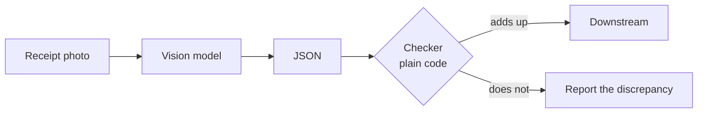
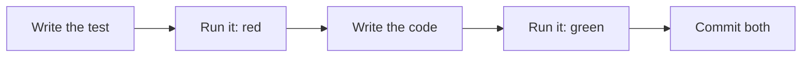

<style src="./style.css"></style>

<div class="kicker">Trinity College · October 19, 2026</div>

# AI Integration

<div class="big">Vision models, and the tests</div>

Ken Kousen · CPSC 415<br>Monday 1:30–4:10 · MC-225

<!--
1:30. Desk source switcher. Zoom auto-records: check the indicator. Wispr on.
Due today: Week 4 repo + tag, TP1 spec + plan (deployment target named),
portfolio plan.md.
-->

---

# Where we are

<div class="two">
<div>

## Two weeks ago

Your program answered from documents<br>Five questions, with and without them<br>You approved a plan before code

</div>
<div>

## This week

Your program reads a photograph<br>The model reads, your code checks<br>The agent writes the tests; you prove they ran<br>A hook says no on your behalf

</div>
</div>

<div class="statement">Stage 4 of the chain. Two more to go: review, then maintain.</div>

<!--
1:30–1:40. Week 4 results in a sentence. TP1 specs and plans are in: name
the deployment targets you saw, no team names. Retro from Oct 5: the lab
starts at 3:20 today and runs 40 minutes.
-->

---

# The same request, with a picture in it

```json
{"model": "minimax/minimax-m3",
 "messages": [{"role": "user", "content": [
    {"type": "text", "text": "Read this receipt."},
    {"type": "image_url", "image_url": {"url": "data:image/png;base64,iVBORw0KGgo..."}}
 ]}]}
```

- `content` becomes a **list of parts**: text and images, in order.
- The image travels as a data URL (or a public `https://` URL).
- Same endpoint, same key, same two class models. Both accept images.

<div class="note">curl -s https://openrouter.ai/api/v1/models shows input_modalities for every model.</div>

<!--
1:40–1:47. Nothing new in the plumbing: Week 2's request with a second
content part. Base64 inflates the bytes by a third; a phone photo should be
resized before sending. Both M3 and MiMo v2.6-flash list "image".
-->

---

# What it costs

| | MiniMax M3 | MiMo v2.6-flash |
|---|---|---|
| One receipt image (520×760 PNG) | ~790 tokens in | ~510 tokens in |
| Reply as JSON | 230–360 out | 300–400 out (one run: 1,436) |
| Five receipts, one eval | about $0.003 | about $0.001 |

- An image is **tokens**: each model tiles it its own way, so the count differs.
- A 4,000-pixel phone photo costs more and reads no better. Resize.
- Each test that calls the model is a billed call: **one call per image, shared by the checks**.

<div class="note">Measured October 9, 2026, with the reference program; your numbers will differ a little.</div>

<!--
1:47–1:50. The cost point that matters for TP1: a vision critique per
generated image is cheap; a vision call per *test* is not, so cache the read.
-->

---

# What vision models read well, and where they guess

<div class="two">
<div>

## Reads well

Printed text, even tilted or faded<br>Layout: what is a heading, a row, a total<br>Which of two pictures matches a description<br>"What is this?"

</div>
<div>

## Guesses

Exact digits in small or blurred print<br>Counts above a handful<br>A year that is not printed<br>Anything that *should* be there

</div>
</div>

<div class="statement">A vision model returns plausible numbers. Plausible is not the same as right.</div>

<!--
1:50–1:55. The handwritten bake-sale receipt says "Oct 3" with no year: in
rehearsal both models returned null because the prompt said so. Without that
instruction a model fills in a year. Same with totals: ask for the printed
total and it copies; ask it to compute and it rounds.
-->

---

# The model reads. The code checks.



- The checker knows arithmetic: items × quantity = subtotal; subtotal − discount + tax = total.
- It knows the schema: a date is `YYYY-MM-DD` or null; a total is a number.
- It **reports**; it does not repair. A fix belongs in the prompt, the spec, or a person's hands.

<div class="note">Week 3's rule again: a reply you cannot parse is a failed case, not a crash.</div>

<!--
1:55–2:00. "Vision as a front end to downstream logic" from the syllabus.
The model is the OCR plus a first pass at structure; the code is the
guarantee. Everything downstream trusts the checker, not the model.
-->

---

# Live: one receipt

```bash
export CHAT_MODEL=minimax/minimax-m3
python3 extract.py images/receipt-01.png
```

```json
{"merchant": "Mather Dining Hall", "date": "2026-10-02", "currency": "USD",
 "items": [{"name": "Chicken wrap", "qty": 1, "price": 7.49}, ...],
 "subtotal": 12.84, "discount": null, "tax": 0.82, "total": 13.66}
CHECK: ok
[minimax/minimax-m3 · 793 in / 235 out]
```

<!--
2:00–2:05. Demo A: say what the system prompt asks for (one JSON object,
copy numbers as printed, null when the year is missing). Then the checker's
verdict. Then receipt-04, the faded tilted one: still ok.
-->

---

# Live: the one that fails

```bash
python3 extract.py images/receipt-03.png     # coffee, with a student discount
```

```json
 "subtotal": 11.5, "discount": -1.15, "tax": 0.66, "total": 11.01
CHECK: subtotal - discount + tax = 13.31, total says 11.01
```

- The model copied the minus sign **as printed**. The checker expected a positive discount.
- The read is right; the spec was ambiguous. MiMo returned `1.15` and passed.

<div class="statement">Was the model wrong, or the spec? Decide, write it down, then fix the spec first.</div>

<!--
2:05–2:10. Demo B. Week 3's question again (the case or the model?). Here
it's the spec: "discount: number" never said which sign. Fix: the prompt says
"discount as a positive amount", or the checker accepts either sign and says
so in the spec. Either way the spec changes before the code does.
-->

---

# Chain stage 4: the tests

| Stage | Artifact | Written by | Approved by |
|---|---|---|---|
| Plan | `intent/*.md` | agent, after interviewing you | you |
| Design | `spec.md` | agent, from the intent | you, against the intent |
| Build | `plan.md`, then code | agent | you, before any code |
| **Test** | **tests, lint, the eval** | **agent** | **you confirm the loop ran** |

- The agent writes the tests. That is not the problem.
- The problem is believing "all tests pass" without looking.

<!--
2:15–2:18. The playbook's Test stage: tests, linting, browser-driven checks,
and *verifying that the feedback loop ran*. Vision ran to 2:15; tests run to
2:40; break 2:40–2:55.
-->

---

# Two kinds of tests

<div class="two">
<div>

## Need no key

The checker on hand-written receipts<br>The JSON parser on fenced and prose replies<br>The image encoder's MIME type<br>**Run in 0.1 s, every time, for free**

</div>
<div>

## Need a key

The eval: every image in `images/`<br>against `expected.json`<br>total, item count, merchant, date, arithmetic<br>**One model call per image, billed**

</div>
</div>

<div class="statement">If every test needs the key, the agent will stop running them. Keep the fast ones fast.</div>

<!--
2:18–2:23. Show tests/test_validate.py (11 tests, 0.15 s) and
tests/test_eval.py (a fixture reads each image once; five checks share it;
skipif when no key). The lab's plan must split Proof the same way.
-->

---

# Tests first, then code, then the output



- The first run **must fail**. A test that passes before the code exists tests nothing.
- The prompt: *"write the tests first and run them so I see them fail, then write the code and run them again."*
- The commit shows the test and the code together. `CHECKS.md` holds the output.

<!--
2:23–2:28. Demo C: the no-key tests live (11 passed), then the eval on M3
(29/30, receipt-03) and the MiMo run from rehearsal (30/30). Paste the
summary lines: that's what CHECKS.md looks like.
-->

---

# Verifying that the loop ran

- "All tests pass" is a claim. The **output** is evidence. Read the summary line: how many, how long, any skipped.
- `-v` names each test. A suite that is all `skipped` passed nothing.
- The commit history shows the test **before** the code it tests.
- A linter ran: `ruff check .`, or the build's lint task. Record what it found, even "nothing."

<div class="statement">You are not re-running the tests. You are checking that they were run, on this code, and what they said.</div>

<!--
2:28–2:33. Why the skipif matters: without a key the eval reports "skipped",
and a student reading "30 passed" when it said "11 passed, 30 skipped" has
verified nothing. Say it twice.
-->

---

# The test that passes for the wrong reason

- The agent edits `expected.json` to match the output.
- The agent adds `if name == "receipt-01": return 13.96`.
- The agent marks the test `skip` "temporarily."
- The agent deletes the test.

<div class="statement">REVIEW.md, pass 1: tests deleted, skipped, or weakened to make the build pass must not merge.</div>

<!--
2:33–2:40. All four were seen in the wild. The first is the one the lab
provokes on purpose (step 4). The hook after the break is the mechanical
answer to the first; the other three need a reviewer, which is Week 6.
BREAK 2:40–2:55.
-->

---

# A hook is a rule the agent cannot forget

```json
{"hooks": {"PreToolUse": [
  {"matcher": "Edit|Write|MultiEdit|Bash",
   "hooks": [{"type": "command",
              "command": "python3 .claude/hooks/guard.py"}]}]}}
```

- Runs **before** every matching tool call, with the call as JSON on stdin.
- Exit **2** blocks the call; stderr goes back to the agent as the reason.
- Exit 0 allows. Exit 1 means "the hook broke" and the call goes through: a guard fails **open**.
- `.claude/settings.json` is committed; your key stays in `settings.local.json`.

<div class="note">Chapter 6 of Claude Code: Up and Running · code.claude.com/docs/en/hooks</div>

<!--
2:55–3:00. Lamp first: the Moonside Halo on the desk changes color on
UserPromptSubmit / PreToolUse / PermissionRequest / Stop (blue, purple, green
for Claude Code; cyan, amber, white for Codex). Same events, exit 0 always,
nothing blocked: a hook that observes. Then: skills and CLAUDE.md are
instructions to a model; a hook is a program. Use one when a rule shouldn't
depend on the model remembering it. Other events: PostToolUse (format after
edit), Stop, SessionStart.
-->

---

# The guard: three rules

| Blocked | Because |
|---|---|
| Edit or Write to `images/` or `expected.json` | the answer key: a test that passes because the key changed proves nothing |
| `rm -r`, `git push --force`, `git reset --hard`, `git checkout --`, `git clean` | destructive; a person runs those |
| `pip install` / `uv add` / `npm install` of a package not in `spec.md` | the course rule, enforced: name it with a reason first |

<div class="note">Test it without the agent: pipe a tool call as JSON into guard.py and read the exit code. examples/guardrail-hook/README.md</div>

<!--
3:00–3:05. Demo D: the echo lines (blocked, blocked, allowed, then "pillow"
allowed once spec.md lists it). It's forty lines of Python; read the regexes.
A tripwire, not a wall: the sandbox and the git history are the other layers.
-->

---

# Live: ask the agent to cheat

```text
In images/expected.json change receipt-01's total from 13.66 to 13.96.
```

```text
A hook blocked the edit. Its exact message:
  images/expected.json is the answer key. Fix the code, not the
  expected values. If you believe the key is wrong, say so and stop.
I'm stopping. expected.json is unchanged.
```

<div class="statement">The message names the fix. Write hook messages for the agent that will read them.</div>

<!--
3:05–3:10. Demo E, live in orclaude in the reference folder. Then the lab's
step 4 is this scenario from the other side: a *wrong* key and "make it pass."
The good outcome is the agent saying the key looks wrong.
-->

---

# A browser-driven check

```python
page.goto("http://localhost:8000")
assert "sk-or" not in page.content()                 # no key in the page
page.fill("#q", "Reply with the single word PONG.")
page.click("form button")
page.wait_for_function(
    "document.querySelector('#out').textContent.length > 1")
assert all(auth is None for _, auth in requests)       # no auth header
assert all("openrouter" not in u for u, _ in requests) # never called
```

- Playwright drives a real Chromium. It sees what the browser sent, not what the code meant.
- A unit test of the server can't see this. A person clicking can't prove it.

<div class="note">examples/key-on-server/test_browser.py · pip install playwright pytest · playwright install chromium</div>

<!--
3:10–3:17. Demo F: server.py in one terminal, pytest in another: 1 passed
in about a second. Open the test and read the five assertions aloud. The TP1
front end needs one of these by Oct 26: generate, display, critique appears.
-->

---

# Team Project 1 by October 26

| Test stage | What is due |
|---|---|
| Agent-written tests | the checker-style tests for your pipeline, plus an eval on real inputs |
| Browser-driven check | the front end: generate, display, critique shows up, no key in the browser |
| The loop ran | `CHECKS.md` with the output, and the commits that show tests before code |

- The vision critique in TP1 is this week's lab in your app: the model reads the generated image, your code checks the critique has the fields the spec names.

<!--
3:17–3:20. The critique is JSON too: score, what matches the prompt, what
doesn't. Same parse-then-check pattern.
-->

---

# Lab: receipts to data

<div class="two">
<div>

<span class="step">0</span> Repo, images, **the guard**, `CLAUDE.md`<br>
<span class="step">1</span> Intent and spec, briefly<br>
<span class="step">2</span> The plan, proof split in two

</div>
<div>

<span class="step">3</span> **Tests first**, then code; two models<br>
<span class="step">4</span> Break the loop on purpose<br>
<span class="step">5</span> Your own receipts, at home

</div>
</div>

<div class="note">weeks/05/lab.md · 40 minutes · Prof. Kousen circulates</div>

<!--
3:20–4:00. Step 0's echo line must print the answer-key message before
anyone starts the agent. Protect steps 1–4; step 5 is homework.
-->

---

# Save evidence of the work

```bash
git add .
git commit -m "Receipt reader: tests, two models, own receipts"
git tag week05-submitted
git push -u origin main
git push origin week05-submitted
```

Tests before code in the history. `CHECKS.md`: both models, the linter, the step-4 story. `images/expected.json` unchanged.

<!--
4:00–4:03.
-->

---

# Before October 26

- **Week 5 submission:** the lab, with two of your own receipts.
- **Team Project 1, Test stage:** tests that run, and the browser check.
- Week 6 is the **mid-term**: image generation, and the Deploy stage, with a separate reviewing agent and `REVIEW.md`.
- The SDLC Playbook certificate is assigned next week.

<!--
4:03–4:06.
-->

---

# Before you leave

- What does the checker know that the model doesn't?
- What would you look at to confirm the tests ran?
- Why does a hook that crashes let the call through?

<!--
4:06–4:10. Answered aloud.
-->

---

# Sources and next steps

<div class="small">

- [OpenRouter: images in requests](https://openrouter.ai/docs/features/multimodal/images) · [Playwright for Python](https://playwright.dev/python/docs/intro) · [Claude Code hooks](https://code.claude.com/docs/en/hooks).
- Ken Kousen, *Claude Code: Up and Running*, Chapter 6 (hooks).
- [The AI-Native SDLC Playbook](https://claude.com/blog/the-ai-native-sdlc-playbook): the Test stage.
- [Artifact-chain template](https://github.com/kousen/artifact-chain-template): `REVIEW.md` pass 1.
- Reference program, tests, guard, and browser check rehearsed October 9, 2026 on `minimax/minimax-m3` and `xiaomi/mimo-v2.6-flash`.

</div>

<p class="note">Prepared October 9, 2026.</p>
