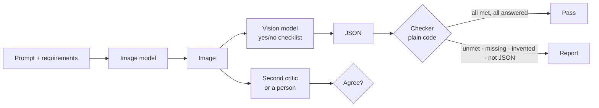

<style src="./style.css"></style>

<div class="kicker">Trinity College · October 26, 2026</div>

# AI Integration

<div class="big">Image generation, and the review</div>

Ken Kousen · CPSC 415<br>Monday 1:30–4:10 · MC-225

<!--
1:30. Desk source switcher. Zoom auto-records: check the indicator. Wispr on.
Due today: Week 5 repo + tag, TP1 Test milestone (tests + browser check).
No lab block today: teaching and demos, lab is homework, walkthrough 3:50.
-->

---

# Where we are

<div class="two">
<div>

## Last week

Your program read a photograph<br>The model read, your code checked<br>The agent wrote the tests; you proved they ran<br>A hook said no on your behalf

</div>
<div>

## This week

Your program **makes** a picture<br>A model critiques it; your code checks the critique<br>A second model reviews the pull request<br>A gate stops a push that fails

</div>
</div>

<div class="statement">Stage 5 of the chain: Deploy. In the chain that means a reviewed merge, not hosting.</div>

<!--
1:30–1:40. Week 5 results in a sentence; no team names. TP1 Test milestones
are in: name what the browser checks looked like. Nothing is examined today;
the only final is the oral defense in finals week.
Due Nov 2: this lab, TP1 with presentations. SDLC Playbook certificate
assigned today, due Nov 9.
-->

---

# A second request shape

<div class="two">
<div>

## Chat (Weeks 2–5)

`POST /api/v1/chat/completions`<br>`messages` in, `choices[0].message` out<br>tokens priced in and out

</div>
<div>

## Images (today)

`POST /api/v1/images`<br>`prompt`, `aspect_ratio`, `seed` in<br>`data[0].b64_json` + `media_type` out<br>`usage.cost` in the reply

</div>
</div>

- Embeddings had their own endpoint in Week 4. Images have their own too.
- `GET /api/v1/images/models` lists what the endpoint can call.

<div class="note">Some image models also answer on the chat endpoint with modalities=["image","text"]. Same model, two doors.</div>

<!--
1:40–1:47. The point is the shape, not the vendor: a provider exposes
several request shapes and your spec says which one each component uses.
-->

---

# Raw, and through the SDK

<div class="two" style="grid-template-columns: 1.25fr 1fr">
<div>

```python
url = "https://openrouter.ai/api/v1/images"
body = {"model": MODEL, "prompt": PROMPT,
        "aspect_ratio": "1:1", "seed": 415}
hdr = {"Authorization": f"Bearer {KEY}",
       "Content-Type": "application/json"}
req = urllib.request.Request(url,
      json.dumps(body).encode(), hdr)
d = json.load(urllib.request.urlopen(req))
b64 = d["data"][0]["b64_json"]
```

</div>
<div>

```python
from openrouter import OpenRouter
client = OpenRouter(api_key=KEY)
r = client.images.generate(
  model=MODEL, prompt=PROMPT,
  aspect_ratio="1:1", seed=415)
b64 = r.data[0].b64_json
print(r.usage.cost)
```

</div>
</div>

- Same request, plumbing done, typed replies. A **dependency**: `pip install openrouter`, named in `spec.md`.
- It can hide an option: MiMo's `reasoning.enabled` has no SDK field; the SDK form is `reasoning={"effort": "none"}`.

<!--
1:47–1:52. Weeks 2–5 were urllib on purpose so the request was visible.
Now that they have seen it, the SDK is allowed and is the lab's path.
What it hides: the HTTP status, the raw body, and options its typed model
lacks. Found Oct 20: MiMo kept thinking through the SDK until the reasoning
flag was changed to effort none. When an SDK call misbehaves, capture what
it sent (httpx event hook) and compare with the raw request.
-->

---

# Live A: five images, with the bill

```bash
python3 generate.py prompts.json --out images
```

```text
images/poster-01.jpg  image/jpeg  seed=415  $0.014  3.3s
images/poster-02.jpg  image/jpeg  seed=416  $0.014  3.0s
images/poster-03.jpg  image/jpeg  seed=417  $0.014  2.8s
images/poster-04.jpg  image/jpeg  seed=418  $0.014  3.6s
images/poster-05.jpg  image/jpeg  seed=419  $0.014  4.5s
5 images, $0.0700 total, manifest in images/manifest.json
```

- `black-forest-labs/flux.2-klein-4b`: **$0.014** per 1:1 image from `usage.cost`, 3–4.5 s (measured October 20).
- The manifest records prompt, seed, model, media type, and cost **per image**, so nothing downstream guesses.

<!--
1:52–2:00. Demo A in examples/image-set with the class key (~17 s, $0.07).
Open the five posters: three of the five titles are misspelled (02, 03, 05 on
Oct 20). Don't explain yet; Live B comes back to it. Read the manifest aloud:
this is what the critic and the checker work from.
-->

---

# Seeds, and what "the same" means

- Same model + same prompt + same **seed** → the same picture, when the model honors the seed. Not always the same **bytes**: FLUX on Oct 20 gave the same picture twice and two different JPEG files.
- Different seed → a different picture of the same thing.
- That is what makes an image **set** reproducible and a billed test repeatable.
- The lab asks you to generate one prompt twice with one seed and say whether the picture matched, and whether the file did.

<div class="statement">A test that generates a fresh random image every run is not testing anything you can name.</div>

<!--
2:00–2:04. Not every model honors seeds exactly; the honest answer is "check
it and write down what you saw." So a byte-for-byte test of a generated image
is the wrong test; the title read is a better one. The comparison model is
token-priced: google/gemini-3.1-flash-lite-image, $0.034 measured Oct 20; it
invented a semester, a room number and a URL on the poster (show it).
-->

---

# Prompt and style control

| You say | The model does |
|---|---|
| Subject and scene: "a robot and a student at a whiteboard" | composes it |
| Style: "hand-drawn, marker on paper, warm colors" | renders in that style |
| Text: `the title "AI Integration", large, legible` | tries; text is where image models most often fail (3 of 5 posters on Oct 20) |
| `aspect_ratio`, resolution, output format | shapes the file |
| What to leave out: "no other text" | sometimes; a negative is weaker than a positive |

- Write prompts as **requirements you can check**: each clause becomes a yes/no question later.

<!--
2:04–2:10. Show two posters from the set: same family, one variable changed.
The checklist in the lab is literally the prompt's clauses turned into
questions. If a clause cannot be checked by looking, it is decoration.
-->

---

# Provenance: what a generated image carries

- Some generators embed an invisible watermark: `google/gemini-3.1-flash-lite-image` output carries **SynthID**, Google's watermark, detectable by their tools after cropping or recompression.
- FLUX output through OpenRouter carries no such mark; your **manifest** is its provenance: prompt, seed, model, date.
- Metadata in the file (EXIF, C2PA) can be stripped by any editor. The manifest you commit cannot be stripped by accident.
- Course rule, from the syllabus: no images of real people; generated media is labeled as generated where the API supports it, and in your README where it does not.

<div class="note">Provenance is a record of how the image came to be. Keep the record next to the image.</div>

<!--
2:10–2:15. Describe, don't rank: SynthID is one vendor's approach; C2PA is
an open standard some tools write. The thing every student can do today is
the manifest. Tie back to Week 1's responsible-AI module.
-->

---

# The loop



- The generator is a model. The critic is a model. **Only the checker is code.**
- The checker compares the critique with the requirements; it does not look at pixels.

<!--
2:20–2:26. Week 5 backwards: there the model read and the code checked the
arithmetic. Here the model draws, a model reads, and the code checks that
the reading answered the question asked. Then the second critic.
-->

---

# The critique is a checklist, not an essay

```text
Answer every item below with true or false, strictly from what is visible.
Reply with one JSON object and nothing else:
{"checks": [{"requirement": "<item, copied exactly>", "met": true, "evidence": "..."}]}

- There is a robot in the image
- There is a whiteboard in the image
- The style looks hand-drawn, not photographic
```

The code then asks:

- Was **every** requirement answered? (missing)
- Was anything answered that was **not asked**? (invented)
- Was each one **met**?
- Was it JSON at all? (a non-JSON critique is a failed critique, not a crash)

<!--
2:26–2:30. Week 3's structured output: a fixed shape so the code can
compare. "Copied exactly" matters: the checker matches requirement text,
loosely (case, punctuation). Show tests/test_checker.py: nine tests, no key.
-->

---

# Live B: the critic that was wrong

```text
poster-02: ok  title read: 'AI INTEGATION' (MISMATCH)
poster-01: ok  title read: 'AI Integration' (match)
```

Open-ended *"Critique this poster"* on poster-01, MiniMax M3:

```text
Oct 19: ... the title appears to be misspelled as "Integratlon" ...
Oct 20: # Critique of the "AI Integertion" Poster
```

- Poster-02: the generator misspelled it; the narrow read caught it. Poster-01: the generator was right; the critic invented a typo, a different one each day.
- The second critic read poster-02's `INTEGATION` as "AI INTEGRATION": it corrected what was printed.

<div class="statement">A critique is model output. Check it like any other.</div>

<!--
2:30–2:38. Demo B: critique.py on the set (M3, ~18 s): the narrow read flags
02, 03, 05, which really are misspelled. Then the open-ended prompt on
poster-01 (open_ended.py): on Oct 20 it claimed "Integertion" and a
handshake; if it doesn't reproduce, show reference/open-ended-2026-10-20.md.
Then --compare against the MiMo file: MiMo "fixed" INTEGATION. Three ways
to check a critic: a second model, a narrow question compared in code, a
person looking. The lab does all three.
-->

---

# Three ways to check the critic

| Check | Catches | Costs |
|---|---|---|
| A **narrow question** compared in code: "write the title exactly" `==` expected | misread text, drifted answers | one small call per image |
| A **second model** on the same checklist; code lists disagreements | a critic that is confidently wrong alone | a second critique per image |
| A **person** looks at the disagreements | everything the models agreed wrongly on | your time, on the few images that disagree |

- Agreement is not proof. Disagreement is a **pointer** to where to look.
- Team Project 1's critique path should have at least the first.

<!--
2:38–2:45. The Jev / second-model review from Week 3 is the same idea.
BREAK 2:45–3:00.
-->

---

# Chain stage 5: Deploy

| Stage | Artifact | Written by | Approved by |
|---|---|---|---|
| Plan | `intent/*.md` | agent, after interviewing you | you |
| Design | `spec.md` | agent, from the intent | you, against the intent |
| Build | `plan.md`, then code | agent | you, before any code |
| Test | tests, lint, the eval | agent | you confirm the loop ran |
| **Deploy** | **a pull request + review findings** | **agent; a separate agent reviews** | **the code owner merges** |

- "Deploy" here is the reviewed merge. Where the code runs is Week 7.

<!--
3:00–3:05. The playbook's Deploy stage: a reviewing agent against REVIEW.md,
hooks gate anything risky, the release is a human decision. One stage left:
maintain.
-->

---

# Why a pull request, when an agent wrote the code

- A PR is the **unit of review**: one feature, one diff, one conversation, one decision.
- The agent that wrote the code has the same blind spots in review. A **different** reviewer is the point, model or person.
- The findings and the replies stay on the PR: that is the evidence for the chain.
- `main` is what the team runs. Nothing lands there without a second look.

```bash
git checkout -b week06-yourname
# ... tests first, then code ...
git push -u origin week06-yourname
gh pr create --base main --fill
```

<!--
3:05–3:10. Template CLAUDE.md already says "one feature per branch, never
push to main." Week 6 is where that rule starts to matter.
-->

---

# REVIEW.md: four passes, ranked

| Pass | Name | Examples |
|---|---|---|
| 1 | **Must not merge** | secrets in the diff; code that does not match `spec.md`; tests deleted, skipped, or weakened; destructive ops without a guard |
| 2 | **Must fix before merge** | model output used as fact without validation; missing handling for a failure the spec lists; no test for the behavior the PR claims |
| 3 | Should fix | duplicated logic, dead code, unclear names; unnecessary calls, a frontier model where the spec chose a cheap one |
| 4 | Nice to have | documentation and comments |

**How to report:** one finding per line: severity, file and line, what is wrong, what to do instead.

<!--
3:10–3:15. Read from the template. Pass 1 and 2 fail the review; 3 and 4
are advice. The report format is what makes it machine-readable: the
reviewer script parses exactly these lines.
-->

---

# The reviewer is a second model

```bash
python3 examples/pr-review/review.py; echo "exit $?"
```

```text
Pass 1: Must not merge (2)
  generate.py:4: hardcoded API key committed -> read os.environ, rotate it
  generate.py:6-11: `make` never calls `critique`; spec requires it -> call it
Pass 2: Must fix before merge (2)
  generate.py:10: json.loads(...)["verdict"] trusts model output -> validate
  generate.py:11: new `critique` behavior has no test -> add one
[minimax/minimax-m3 · 908 in / 1385 out · cost 0.0015]
exit 1
```

- In: `REVIEW.md`, `spec.md`, the diff. Out: findings by pass. Exit 1 on pass 1 or 2; exit 2 when it did not answer in form: a gate **fails closed**.
- It can be wrong both ways: check each finding against the code; a wrong one gets a reply on the PR.

<!--
3:15–3:22. Demo C: the scratch repo from make_review_repo.sh, branch
`feature` with a planted key and an unchecked json.loads. Run review.py (M3,
~9 s, $0.0015): the output above is the Oct 20 run. Then MiMo for $0.00007,
same pass-1 findings. Remove the plant (generate-main.py), run again, expect
exit 0 or pass-3 advice. gh pr comment --body-file is in the lab, not run
here (no PR in a scratch repo). Contrast with the Week 5 hook: that one
fails open; a gate must not.
-->

---

# Release gates: a rule the push cannot skip

<div class="two">
<div>

## Pre-push hook (your machine)

```sh
#!/bin/sh
set -e
ruff check .
env -u OPENROUTER_API_KEY \
  python3 -m pytest -q
```

`cp gate.sh .git/hooks/pre-push`

</div>
<div>

## CI (GitHub Actions)

```yaml
on: [pull_request]
steps:
  - run: pip install pytest ruff
  - run: ruff check .
  - run: python3 -m pytest -q
```

Required check on `main` → red cannot merge

</div>
</div>

- Free and fast on purpose: the key is removed, model tests skip. A gate that costs money gets switched off.
- Three hooks now: Claude Code's `PreToolUse` (the guard), git's `pre-push`, and CI. Different moments, same idea.

<!--
3:22–3:30. Demo D: in the reference repo, break a test, git push, watch the
hook stop it; fix, push, it goes. Say what the gate catches that REVIEW.md
cannot: the reviewer reads a diff; the gate runs the code.
-->

---

# Team Project 1 on November 2

| | |
|---|---|
| Submission | one member: repository URL + tag `tp1-submitted`, Moodle, 1:30 PM |
| Presentation | **10 minutes per team** + 5 of questions: the app live, one artifact on screen, one thing that broke |
| Order | drawn at the start of class |
| Peer sheet | each team gets written notes from the others; **format to be confirmed** by email before Nov 2 |
| Chain | intent, spec, plan, tests, at least one reviewed PR **per member**, `ANNOTATION.md` |

- This week's lab PR is one of those reviewed PRs.

<!--
3:30–3:40. Logistics, then questions. Peer sheet format: say it will be
confirmed; don't promise a shape yet. Every member explains every part:
expect a question to the member who did not write the piece on screen.
-->

---

# Lab: generate, critique, check, review

<div class="two">
<div>

<span class="step">0</span> Week 5 repo, `week06/`, SDK, rules<br>
<span class="step">1</span> Intent and spec: generator, critic-checker<br>
<span class="step">2</span> Plan, proof split, with the cost<br>
<span class="step">3</span> Tests first, then the checker

</div>
<div>

<span class="step">4</span> Five images, five critiques, ~$0.15<br>
<span class="step">5</span> **The critic was wrong:** second model, narrow question, your eyes<br>
<span class="step">6</span> Branch, PR, reviewer, gate, merge, in the **team repo**

</div>
</div>

<div class="note">weeks/06/lab.md · about 60 minutes plus the PR review · due November 2 with TP1</div>

<!--
3:50–4:00. Walk the sheet. Step 0's guard line must refuse "pip install
openrouter" until the spec names it. Step 6 needs a teammate to approve:
open the PR early. Submission is the PR URL plus the tag.
-->

---

# Before November 2

- **Week 6 submission:** PR URL in the team repository + `week06-submitted` on your Week 5 repository.
- **Team Project 1:** complete, presented in class.
- **Assigned today:** the AI-Native SDLC Playbook course on Claude Academy; certificate due **November 9**. You have run every stage; now learn their names.
- Week 7 is presentations, then **audio**: speech in and speech out for the portfolio chatbot.

<!--
4:00–4:04.
-->

---

# Before you leave

- What does the checker know that the critic doesn't?
- Why does the reviewer fail closed when the guard fails open?
- What does the gate run that `REVIEW.md` can only read?

<!--
4:04–4:10. Answered aloud.
-->

---

# Sources and next steps

<div class="small">

- [OpenRouter: image generation](https://openrouter.ai/docs/features/multimodal/image-generation) · [openrouter on PyPI](https://pypi.org/project/openrouter/) · [gh pr](https://cli.github.com/manual/gh_pr) · [Git hooks](https://git-scm.com/docs/githooks) · [Claude Code hooks](https://code.claude.com/docs/en/hooks).
- [The AI-Native SDLC Playbook](https://claude.com/blog/the-ai-native-sdlc-playbook): the Deploy stage; the [Academy course](https://academy.claude.com/courses/ai-native-sdlc-playbook) assigned today.
- [Artifact-chain template](https://github.com/kousen/artifact-chain-template): `REVIEW.md`, the four passes.
- Image generation, the critique, and the reviewer rehearsed October 19–20, 2026 on `black-forest-labs/flux.2-klein-4b`, `google/gemini-3.1-flash-lite-image`, `minimax/minimax-m3`, and `xiaomi/mimo-v2.6-flash`; prices quoted are those runs' `usage.cost`.

</div>

<p class="note">Prepared October 19–20, 2026.</p>
