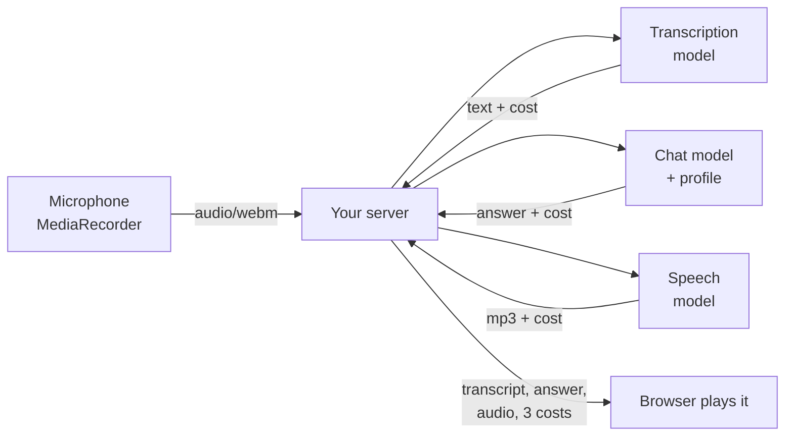

<style src="./style.css"></style>

<div class="kicker">Trinity College · November 2, 2026</div>

# AI Integration

<div class="big">Team Project 1 presentations, then the program listens and speaks</div>

Ken Kousen · CPSC 415<br>Monday 1:30–4:10 · MC-225

<!--
1:30. Desk source switcher. Zoom auto-records: check the indicator. Wispr on,
mic stays on at the break. Due today: TP1 (one member, tag tp1-submitted),
Week 6 (PR URL + tag), portfolio chatbot milestone (feedback only).
-->

---

# This afternoon

| | |
|---|---|
| 1:35–2:35 | **Four presentations**, 10 minutes + 5 of questions, order drawn now |
| During each team's questions | the other teams fill in the **peer notes form** (link on Moodle and the Week 7 page) |
| 2:35–2:45 | What the room saw |
| 3:00–3:40 | **Audio:** speech in, speech out, the transcript checked in code |
| 3:40–3:50 | **Hosting:** where the key lives, and the proof |
| 3:50–4:10 | The lab (due Nov 9), questions |

<div class="note">Every member explains every part. Expect a question to the member who did not write the piece on screen.</div>

<!--
1:30–1:35. Draw the order (four slips). Form: three questions, one
submission per presenting team, your name not shown to them, counts toward
participation. Phones are fine for the form.
-->

---

# Presentations: what to show

- The app **running**, one use case end to end. Localhost is fine.
- One **artifact** from the chain on screen: the intent, the spec's model decision, the plan's Proof, a PR with the reviewer's findings.
- One thing you **tried that failed**, or took out. What you did about it.
- The chain exists: intent, spec, plan, tests, a reviewed PR **per member**, `ANNOTATION.md`.

<div class="statement">Ten minutes. Then five of questions, and a question goes to whoever did not write the part we are looking at.</div>

<!--
Keep time visibly. At 9 minutes, say "one minute." Questions from the room
first, then mine. While they answer, the others write.
-->

---

# The peer notes form

<div class="two">
<div>

1. One thing this team did that you would **borrow** for your own project, and why.
2. One question you would ask them in a **Comprehension Defense**: something you would need explained before you believed it works.
3. One claim you were **not convinced by**, and what evidence would convince you.

</div>
<div>

- Once per presenting team, during their question time.
- Your name is recorded, not shown to them.
- Each team gets the notes written about them.
- Every row counts toward participation.

</div>
</div>

<!--
Question 3 is this course's theme applied to people: a claim on screen is
model output until checked. Question 2 is Defense practice for the asker.
-->

---

# What the room saw

- Which critique paths actually read the image, and which only read the prompt?
- Where did a second model disagree with the first, and who was right?
- Which PR findings were real, and which were the reviewer being confidently wrong?
- What did the projects cost, and what was the most expensive single call?

<!--
2:35–2:45. Patterns across the four, no rankings. If a team's critic never
read the image, say what that would take. Then BREAK 2:45–3:00.
-->

---

# Two more request shapes

<div class="two">
<div>

## Speech → text

`POST /api/v1/audio/transcriptions`<br>`model`, `input_audio: {data, format}` in<br>JSON out: `text`, `usage.seconds`, `usage.cost`<br>priced **per second** of audio (or per token)

</div>
<div>

## Text → speech

`POST /api/v1/audio/speech`<br>`model`, `input`, `voice`, `response_format` in<br>**audio bytes** out, `X-Generation-Id` header, no usage<br>priced **per character** of text

</div>
</div>

- Same key, same base URL, as chat (Week 2), embeddings (Week 4), images (Week 6).
- `GET /api/v1/models?output_modalities=transcription` and `=speech` list what each endpoint can call, with prices and voices.

<!--
3:00–3:07. The point is the shape. Audio in travels as base64 in JSON like
the receipt image did in Week 5. Audio out is raw bytes: the reply is the
file, so there is nowhere to put a usage object.
-->

---

# Raw, and through the SDK

<div class="two" style="grid-template-columns: 1.2fr 1fr">
<div>

```python
b64 = base64.b64encode(open("q.wav","rb").read()).decode()
body = {"model": STT, "input_audio":
        {"data": b64, "format": "wav"}}
req = urllib.request.Request(
  "https://openrouter.ai/api/v1/audio/transcriptions",
  json.dumps(body).encode(),
  {"Authorization": f"Bearer {KEY}",
   "Content-Type": "application/json"})
d = json.load(urllib.request.urlopen(req))
print(d["text"], d["usage"]["cost"])
```

</div>
<div>

```python
r = client.stt.create_transcription(
  model=STT,
  input_audio={"data": b64,
               "format": "wav"})
print(r.text, r.usage.cost)

r = client.tts.create_speech(
  model=TTS, input=text,
  voice=VOICE, response_format="mp3")
data = r.read()      # bytes
```

</div>
</div>

- The speech reply is a stream: `read()` it, check the content type is `audio/…` **before** saving, or you will save a JSON error as `.mp3`.

<!--
3:07–3:12. The SDK form is three lines each way. What it hides this time:
the streaming response (read() it) and the content-type check, which the
example does for you. Found Oct 26: the first version of speak.py did neither.
-->

---

# Live E: one sentence, six voices

```bash
python3 speak.py "Welcome to CPSC 415. Today the program listens, and then it speaks." --voice en-US-Harper:MAI-Voice-2.1-Flash
python3 speak.py "..." --voice en-GB-Emily:MAI-Voice-2.1-Flash
python3 speak.py "..." --voice en-IN-Priya:MAI-Voice-2.1-Flash
python3 speak.py "Bienvenidos a CPSC 415. ..." --voice es-MX-Valeria:MAI-Voice-2.1-Flash
python3 speak.py "सीपीएससी 415 में आपका स्वागत है। ..." --model x-ai/grok-voice-tts-1.0 --voice eve
python3 speak.py "..." --model elevenlabs/eleven-v4-turbo --voice george
```

| Model | Per character | 67 characters | Time |
|---|---|---|---|
| `microsoft/mai-voice-2.1-flash` (class) | $0.000015 | **$0.0010** | 0.5–0.8 s |
| `x-ai/grok-voice-tts-1.0` | $0.000015 | $0.0011 | 0.9 s |
| `elevenlabs/eleven-v4-turbo` | $0.000040 | $0.0027 | 1.5–2.1 s |
| `hexgrad/kokoro-82m` (open weights) | $0.0000006 | $0.00004 | 0.4 s … 197 s |

<!--
3:12–3:20. Play the clips from instructor/week07/reference/accents (made Oct
26): Harper, Emily, Priya; Valeria in Spanish; Grok's eve in Hindi (it
auto-detects the language); George. Ask the room which locales they want;
MAI has 23. The voice id belongs to the model: George is not a MAI voice.
Kokoro's 197-second call was the Hindi one; cheap is not the same as fast.
-->

---

# Live F: a clip, transcribed, and checked

```text
clip-02.wav: ok  wer=0.0  missing=[]  6.45s audio  $0.0000215  0.7s
    got: "Have you ever deployed anything with Kubernetes? Be honest, I'm comparing you with a boot camp graduate."
```

- The transcript is **model output**. The code cannot hear; it can measure.
- **Word error rate** against the text you wrote down first: edits per expected word.
- **Words that must survive:** your name, the course number. "boot camp" counts as "bootcamp"; "Cousin" does not count as "Kousen".
- An **empty** reply is a failed transcript, not a crash.

```text
openai/whisper-large-v3-turbo   $0.0000033 per second    6 s clip ≈ $0.00002
elevenlabs/scribe-v2            $0.00006  per second     6 s clip ≈ $0.0004
```

<!--
3:20–3:27. Demo: transcribe.py --set clips/expected.json (three clips,
$0.00007). Then --model elevenlabs/scribe-v2. Read the two side by side.
Oct 26: Whisper wrote "boot camp" and, on one run, appended "Music" to the
trailing silence; Scribe read every clip exactly. Then the lesson on the
next slide.
-->

---

# The transcript that stopped halfway

```text
clip-02.mp3 (Kokoro):  whisper  3.1 s audio  "Have you ever deployed anything with Kubernetes?"
clip-02.mp3 (Kokoro):  scribe   6.5 s audio  "... I'm comparing you with a bootcamp graduate"
```

- Two cheap speech models wrote MP3s whose **header says the wrong length**. Whisper's host trusted the header: `usage.seconds` matched the header, not the audio.
- Scribe decoded the audio and read all of it.
- The fix is not a better model: ask for **PCM** and write the WAV yourself (`wave`, standard library). No header, nothing to be wrong.

<div class="statement">Both models were fine. The pair failed. The second transcriber is what told us.</div>

<!--
3:27–3:32. Week 6 backwards again: there the generator misspelled and the
critic hallucinated; here the speaker wrote a bad file and the transcriber
believed it. The check that caught it was disagreement between two models,
and the proof was a tool that does not use models (afinfo / the wave module).
-->

---

# The loop



- Three billed calls per turn. On the class models: transcription ≈ $0.00002, answer ≈ $0.0005, speech ≈ $0.003 (two or three sentences at $0.000015 a character). **About half a cent a turn**, measured $0.0035–0.0057.
- The answer function is the **same one** the typed path uses. The refuse-to-fabricate rule applies to what is said aloud.
- The browser sends audio and gets audio. It never sees the key or the model names.

<!--
3:32–3:38. Demo G: python3 server.py, open the page, hold the button, ask
"Have you ever used Kubernetes?" Hear "No, I haven't" with the reason from
the profile. Show the three costs and the three timings on the page (Oct 26:
0.6–1.9 s + 1.8–3.5 s + 0.7–1.4 s). Found in rehearsal: at max_tokens 400 M3
once spent the whole budget on hidden reasoning and answered nothing, and the
speech model refused the empty string; the server now says so instead. If the room mic is bad,
upload clips/clip-02.wav. Then test_browser.py: the Week 5 assertions.
-->

---

# A third door: audio in a chat message

```python
client.chat.send(model=AUDIO_CHAT_MODEL, messages=[{"role": "user", "content": [
    {"type": "text", "text": "What did the speaker ask, and in what tone?"},
    {"type": "input_audio", "input_audio": {"data": b64, "format": "wav"}}]}])
```

| You want | Use | You get |
|---|---|---|
| the words | `/audio/transcriptions` | text + seconds + cost |
| a model to **reason about** the audio: tone, a question answered from it, audio with an image | `input_audio` part on `/chat/completions` | a chat completion |
| the words spoken | `/audio/speech` | bytes |

- Where media stands, in your own experience now: text mature; images and audio a generation behind and good; video behind that.

<!--
3:38–3:40. Not demoed; the "finish early" item. Same shape as the Week 5
image part. Then hosting.
-->

---

# Hosting: one rule, three hosts

| Host | Your function | Where the key lives |
|---|---|---|
| **Cloudflare Pages** (course default) | `functions/api/ask.js` → `/api/ask`, `env.OPENROUTER_API_KEY` | `wrangler pages secret put`, or the dashboard, encrypted |
| **Vercel** | `api/ask.js` → `/api/ask`, `process.env.…` | Project settings, sensitive |
| **here.now** | no code: a **proxy route** in `.herenow/proxy.json` | a **service variable** injected into the proxied request |
| Your own server | the Week 4 server in a container | the host's environment |

- The site gets **its own key with a credit limit**. A voice turn is about half a cent; a $5 limit is a thousand of them, and when it leaks you rotate one key.
- Cap the route: message length, a rate limit per IP, one model call per request, CORS to your own origin.

<!--
3:40–3:46. Describe, don't rank: all three have free tiers and agent skills
(the deploy mechanics are the agent's job). The decision is a spec decision
with the rejected alternative. weeks/07/hosting.md is the page.
-->

---

# Hosting: the proof

1. **View source** of the deployed page: no key, no model name.
2. **Network tab:** the only request leaving the browser is to your `/api/ask`, with no `Authorization` header. The provider never appears.
3. **grep** the build output and the history for `sk-or`: nothing. (A key in any commit is compromised: rotate.)
4. **The Week 5 browser check against the live URL.** Its last three assertions are the deployment's acceptance test.

<div class="statement">A site that passes all four and answers one question from the test set is deployed. Before November 30.</div>

<!--
3:46–3:50. The four checks, in CHECKS.md. The Defense asks where the key
lives and how you know it is not in the page.
-->

---

# Lab: hear, think, speak

<div class="two">
<div>

<span class="step">0</span> Portfolio repo, `voice/`, SDK in `requirements.txt`, rules<br>
<span class="step">1</span> Intent and spec: transcriber, speaker<br>
<span class="step">2</span> Plan, proof split, with the cost<br>
<span class="step">3</span> Tests first, then the checker

</div>
<div>

<span class="step">4</span> **Your own voice,** two clips, two transcribers, ~$0.002<br>
<span class="step">5</span> The answer spoken, two voices, ~$0.01<br>
<span class="step">6</span> `/api/voice` next to the chatbot; the browser check; one real turn costed

</div>
</div>

<div class="note">weeks/07/lab.md · about 60 minutes plus recording · in your portfolio repository · tag week07-submitted · due November 9</div>

<!--
3:50–4:00. Walk the sheet. Step 4: write expected.json BEFORE the model
hears the clip. No chatbot yet? Use the example's profile and say so. The
"One turn" total goes into the hosting decision.
-->

---

# Before November 9

- **Week 7 submission:** portfolio repository URL + `week07-submitted`.
- **SDLC Playbook certificate** on Moodle (assigned October 26).
- Portfolio: the chatbot milestone was today; the spoken interface is this lab; **deployed** is November 30, with the hosting decision in `spec.md`.
- Week 8 is tool use and function calling, and **Team Project 2** is assigned.

<!--
4:00–4:04.
-->

---

# Before you leave

- Why does the speech reply carry no bill, and where is the bill?
- What did the second transcriber tell us that `usage.seconds` could not?
- What does one voice turn cost, which of the three calls is most of it, and whose decision does that number belong to?

<!--
4:04–4:10. Answered aloud.
-->

---

# Sources and next steps

<div class="small">

- [OpenRouter audio APIs](https://openrouter.ai/blog/announcements/announcing-audio-apis/) · [transcription guide](https://openrouter.ai/blog/tutorials/transcription-on-openrouter/) · [text-to-speech tutorial](https://openrouter.ai/blog/tutorials/text-to-speech/) · [openrouter on PyPI](https://pypi.org/project/openrouter/).
- [MediaRecorder](https://developer.mozilla.org/en-US/docs/Web/API/MediaRecorder) · [Cloudflare Pages Functions](https://developers.cloudflare.com/pages/functions/) · [Vercel environment variables](https://vercel.com/docs/environment-variables) · [here.now docs](https://here.now/docs).
- Transcription, speech, and the loop rehearsed October 26, 2026 on `openai/whisper-large-v3-turbo`, `elevenlabs/scribe-v2`, `microsoft/mai-voice-2.1-flash`, `elevenlabs/eleven-v4-turbo`, `x-ai/grok-voice-tts-1.0`, `hexgrad/kokoro-82m`, `mistralai/voxtral-mini-tts-3-0`, and `minimax/minimax-m3`; prices quoted are those runs' `usage.cost` or the catalog price times characters.

</div>

<p class="note">Prepared October 26, 2026.</p>
