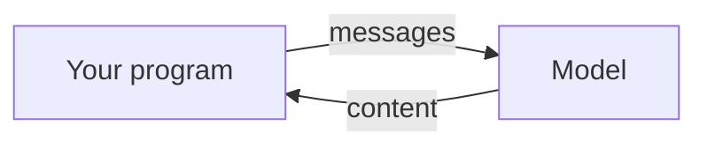
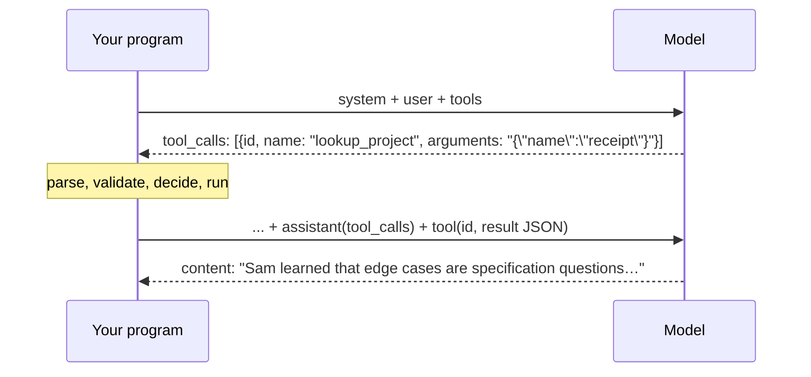

<style src="./style.css"></style>

<div class="kicker">Trinity College · November 9, 2026</div>

# AI Integration

<div class="big">Tool use and function calling: the model asks, the program decides</div>

Ken Kousen · CPSC 415<br>Monday 1:30–4:10 · MC-225

<!--
1:30. Desk source switcher. Zoom auto-records: check the indicator. Wispr on,
pause at the break and resume. Due today: Week 7 (portfolio URL + tag),
SDLC certificate, portfolio tag.
-->

---

# This afternoon

| | |
|---|---|
| 1:30–1:40 | What is due; your peer notes, sanitized, are on Moodle |
| 1:40–2:10 | **The model asks, the program decides:** schema, request, reply, result |
| 2:10–2:40 | **Live A–B:** one tool, one call; the loop with its trace; two models |
| 2:55–3:25 | **Failure modes:** the bad call, the endless loop, the hallucinated tool; **Live C** |
| 3:25–3:40 | Where this goes: Claude Code's tools, the hook, next week's MCP |
| 3:40–3:55 | **Team Project 2** |
| 3:55–4:10 | The lab (due Nov 16), questions |

<div class="note">Until today the model only ever answered. Today it asks for something, and your code decides.</div>

<!--
1:30–1:40. Peer notes: Page in section 8, names removed, each team's rows
are in its TP1 feedback. Thank them for the Defense questions aimed at the
critics. Week 7 lab: what I have seen so far, in general terms only.
-->

---

# Every call so far



- Week 2: text in, text out. Week 4: a vector. Week 5: an image in. Week 6: an image out. Week 7: audio both ways.
- Every time, the model's reply was **the end of the turn**. Your program read it and did whatever it did next.
- The model could not look anything up, run anything, or change anything. It could only say.

<div class="statement">Today the reply can be a request: "run this function with these arguments, and tell me what happened."</div>

<!--
1:40–1:45. Make the point that nothing about the model changes. The request
is text, shaped so your program can parse it. The model still cannot run
anything.
-->

---

# The schema: what the model sees

```json
{"type": "function", "function": {
  "name": "lookup_project",
  "description": "Look up one of the person's projects by name and return its
                  four-question annotation. Use this before saying anything
                  about a project.",
  "parameters": {"type": "object",
                 "properties": {"name": {"type": "string",
                                         "description": "The project's name, or part of it"}},
                 "required": ["name"]}}}
```

- A **name**, a **description**, and the arguments as **JSON Schema**. That is the whole contract.
- The description is an instruction, not a label. "Use this before…" is what makes the model call it.
- Sent with every request as `tools: [...]`. The model is not told how the function works, only how to ask.

<!--
1:45–1:52. Point at "Use this before saying anything about a project." Ask:
what happens if the description just says "Project lookup"? (The model
answers from nothing, or guesses.) JSON Schema: they wrote one in Week 3
for structured output; same thing, other direction.
-->

---

# The request, the reply, the result



- `arguments` is a **string** of JSON the model wrote. Your program parses it. It may not parse.
- The result goes back as a message with `role: "tool"` and the call's `id`, after the assistant message that asked.
- Two chat calls for one question. A tool call is never free.

<!--
1:52–2:00. Three things to say out loud: arguments is a string; the
assistant message with the tool_calls goes back too (the model has no
memory); two calls minimum. Same key, same endpoint as Week 2.
-->

---

# Across providers

| | OpenAI shape (OpenRouter speaks this) | Anthropic native |
|---|---|---|
| Schema | `function.parameters` | `input_schema` |
| The ask | `message.tool_calls[].function.arguments` (string) | `content[].type == "tool_use"`, `input` (object) |
| The result | `{"role": "tool", "tool_call_id", "content"}` | `{"type": "tool_result", "tool_use_id", "content"}` in a user turn |

- One idea, two spellings. OpenRouter translates, so your loop is written once for the models that support `tools`.
- `GET /api/v1/models`: `supported_parameters` contains `"tools"` for the ones that can. Both class models can.
- Next week: MCP makes the schema and the transport a standard, so a host you did not write can discover and call your tools.

<!--
2:00–2:05. Describe, don't rank. The point: the shape is a convention, and
MCP exists because every vendor had one.
-->

---

# Live A: one tool, one call

```bash
cd examples/tool-loop
python3 loop.py "What did Sam learn from the receipt reader project?"
```

```text
step 1  lookup_project({"name":"receipt reader"})  →  {"found": true, "project": {...}}  [0.73s]
step 2  answer  [1.61s, finish=stop]

Sam learned that edge cases are really specification questions, not model bugs. ...

stopped_by=answer  calls=['lookup_project']  cost=$0.000436  check=ok  [minimax/minimax-m3]
```

- The profile is **not in the prompt**. The model knows nothing about Sam except what the tools return.
- Step 1 is the model asking. The program ran `lookup_project`. Step 2 is the model answering from the result.

<!--
2:10–2:18. Run it. Then the same on MiMo (--model). Then "Tell me about Sam's
blockchain voting project": the tool says found: false and lists what
exists; read the answer aloud. On Nov 2 both models said "not on record."
-->

---

# The loop

```python
for step in range(1, max_steps + 1):
    c = client.chat.send(model=model, messages=messages, tools=TOOLS)
    calls = c.choices[0].message.tool_calls or []
    if not calls:
        return answer(c)                                   # the model answered: done
    messages.append(assistant_message_with(calls))         # the ask goes back verbatim
    for tc in calls:
        result = run_tool(tc.function.name, tc.function.arguments)   # parse, validate, decide
        messages.append({"role": "tool", "tool_call_id": tc.id, "content": json.dumps(result)})
return "I couldn't finish answering that in 4 steps."       # the program's answer, not the model's
```

<!--
2:18–2:22. Walk the twelve lines. The last line: whose sentence is that?
-->

---

# One loop, three shapes

- **Single shot:** one ask, one result, one answer.
- **Loop:** the model asks again from what it got back, until it answers.
- **Branching:** it picks among tools, or asks for several in one reply: `tool_calls` is a list, and every entry needs its own result message.

<div class="statement">The cap is the only thing between you and a model that asks forever.</div>

<!--
2:22–2:25. tool_calls is a list: M3 asked for two lookups in one reply on
Nov 2. The program must answer each id or the next call is rejected.
-->

---

# Live B: the trace on two models

`python3 -m pytest tests/test_eval.py -v -s`: five questions, two models, about a cent.

| Question | M3 | MiMo |
|---|---|---|
| the receipt reader (one lookup) | $0.0004, 2 steps | $0.0001, 2 steps |
| an invented project | $0.0003–0.0009, up to 6 calls | $0.0001, 2 calls |
| Kubernetes (`not_yet`) | $0.0002 | $0.0002 |
| "introduce me" (a side effect) | held, $0.0004 | held, $0.0001 |

- Same loop, same tools. The models differ in how many times they ask and in what they write back.

<!--
2:25–2:40. Run the eval with -s and read the traces as they go. REASONING
in loop.py: MiMo needs hidden reasoning off, M3 needs it on (Week 5). M3 on the
invented project: four lookups and two skill checks before it gave up
(Nov 2, first run); the second run, one lookup. Same model, same prompt.
Then break.
-->

---

# Three ways it goes wrong

- **The bad call.** Wrong argument name, wrong type, JSON that does not parse, a tool that does not exist.
- **The loop that never ends.** The same ask, again and again, each one billed.
- **The hallucinated tool, or result.** A tool the schema never offered. Or an answer that claims what no tool returned.

<div class="statement">The model may be wrong in any of these ways on any call. The program must not be.</div>

<!--
2:55–3:00. This is the slide. Each one happened to someone's TP1 agent at
some point; ask the room which.
-->

---

# Plain code catches each one

| Failure | The line that catches it |
|---|---|
| The bad call | `validate()` against the schema; the problem goes back as the **result**, never as an exception |
| The loop that never ends | `max_steps`; the capped answer is **the program's** sentence |
| The hallucinated tool | Unknown name → an error result that lists the tools that exist |
| The hallucinated result | `check_answer()` compares the answer with the trace: a project named without a lookup, a skill called shipped without a check |

<div class="note">What it cannot catch: a project that is not in the profile at all. The tool's not-found result is the evidence; the eval reads the answer for it.</div>

<!--
3:00–3:05. The error message you return is what the model reads next:
make it say what to do ("the tools are [...]").
-->

---

# Live C: misuse, scripted

```bash
python3 -m pytest tests/test_loop.py -v           # no key, under a second
```

```text
test_missing_argument_is_an_error_result                 PASSED
test_invalid_json_arguments_is_an_error_result           PASSED
test_hallucinated_tool_name_goes_back_as_an_error        PASSED
test_endless_caller_stops_at_the_cap                     PASSED
test_side_effect_is_reported_as_pending_not_done         PASSED
test_project_named_without_a_lookup_is_unsupported       PASSED
test_check_cannot_see_an_invented_project                PASSED
```

- A **fake client** whose replies each test scripts. The test says what the model "did"; the assertion says what the program did about it.
- That is how you test a loop without paying for it, and how you test the cases a real model produces only now and then.

<!--
3:05–3:15. Open test_endless_caller_stops_at_the_cap and read it: ten
scripted asks, max_steps=3, three sends, the program's sentence. Then the
last test: an honest limit, in the test suite, on purpose.
-->

---

# Side effects: the program's permission

```python
SIDE_EFFECTS = {"request_intro"}      # never run on the model's say-so alone

if name in SIDE_EFFECTS and not allow_side_effects:
    return {"error": "request_intro has a side effect and needs the visitor's confirmation first",
            "pending": {"tool": name, "arguments": args}}
```

- Reading is cheap to get wrong. Writing, sending, deleting, and spending are not.
- The loop records the ask as **pending**; a person confirms; only then does the function run. On Nov 2 both models answered "I'll need your go-ahead before I send it."
- You have seen this rule twice: Claude Code's permission prompt, and the Week 5 **PreToolUse hook** that refused `rm -rf` and edits to the answer key.

<!--
3:15–3:22. The hook IS this slide: Claude Code's Bash and Edit are tools,
the hook is run_tool's decision. Ask: which of your TP1 tools had side
effects? (Writing files, saving accounts, spending credit.)
-->

---

# Where this goes

| | Who writes the schema | Who runs it | Who decides |
|---|---|---|---|
| Today's loop | you | your program | your program |
| Claude Code | Anthropic (Bash, Read, Edit, …) | the harness | permissions + your hooks |
| MCP (Week 9) | the **server**, discovered by the host | the server | the host, with the user |
| An agent (Week 10) | you, or a server | your loop | your loop, with a cap and a budget |

- Every row is the same four messages. Team Project 2 is the last two rows: a server you write, called by Claude Code and by your own loop.

<!--
3:22–3:30. The whole second half of the course on one slide. MCP's reason
to exist: the schema and the transport are standardized, so a host you did
not write can discover your tools.
-->

---

# Why a tool, when the profile is in the prompt

- The prompt holds what you wrote down. A tool returns what is true **now**: your last commit, today's availability, the live status of a deployed project.
- The prompt is one size. A tool is called only when needed, and only with what was asked for.
- The prompt cannot act. A tool can, which is why the last two slides exist.

<div class="note">The lab's tool: your recent commits from GitHub's public API (no key), or an introduction request with a side effect, or one of your own that returns live data.</div>

<!--
3:30–3:33. Short. Students will ask why not just put everything in the
prompt. Three answers.
-->

---

# A third door: the model writes the code

- Some systems skip the schema: the model writes a program, the program runs in a sandbox, the output goes back. Code execution, computer use, browser agents.
- Same four messages. The "tool" is an interpreter, and the arguments are a script.
- The decide step gets harder: what is a bad call when the call is arbitrary code? That is what the sandbox is for.

<!--
3:33–3:36. Not demoed. Mention so they recognize it when they meet it.
-->

---

# Team Project 2: Agentic / MCP System

- **An MCP server** that a coding agent can call, and **an agent that uses it** for a task that takes more than one model call. The server is required.
- **Two hosts, one task:** Claude Code with the server registered (a saved session transcript), and **your own loop** calling the same server.
- Same four teams. Python, the `mcp` SDK, the `openrouter` SDK; every dependency justified.
- **The program decides:** every tool validates in code; side-effect tools are gated; the loop has a step cap and a cost cap.
- Weight 20%. Presentations **December 7**. Cost: under about $10 in total.

<!--
3:40–3:46. Walk the sheet. The "two hosts" rule is what makes the server
a server. Teams: same four; if anyone needs to move, say so today.
-->

---

# TP2: the milestones

| Date | Milestone |
|---|---|
| **Nov 16** (Week 9) | `intent/` and `spec.md` in the team repository, tag `tp2-intent-spec` (feedback only) |
| **Nov 23** (Week 10) | `plan.md`; the server running and registered in Claude Code (the Week 9 lab); misuse tests for every tool |
| **Nov 30** (Week 11) | Reviewed PRs, one per member; the eval in CI; a packaged skill (the Week 11 lab) |
| **Dec 7** (Week 12) | Tag `tp2-submitted`; presentations, 10 + 5, peer notes |

<div class="note">Each week's lab from here is a piece of this project.</div>

<!--
3:46–3:52. The weekly labs are the milestones; nothing is extra.
-->

---

# TP2: tasks that fit

- A **study assistant**: the server exposes a course's materials and a quiz bank; the agent builds and grades a practice session.
- A **release helper**: the server wraps a repository's tests, linter, and changelog; the agent prepares a release and refuses when the tests fail.
- A **research assistant**: the server searches a document set and records citations; the agent writes a sourced brief and flags what it could not source.
- A **data cleaner**: the server reads and validates a spreadsheet; the agent fixes what it can and reports what it cannot.

<div class="note">Yours, if: more than one model call; at least one tool that could go wrong; one decision the program must make, not the model.</div>

<!--
3:52–3:55. Ask each team for a one-line idea before they leave, or by
Wednesday in the team channel.
-->

---

# Lab: one real tool, and the ways it goes wrong

<div class="two">
<div>

<span class="step">0</span> Portfolio repo, `tools/`, rules<br>
<span class="step">1</span> Choose the tool; intent and spec<br>
<span class="step">2</span> Plan, proof split<br>
<span class="step">3</span> Six misuse tests first, with a **scripted model**

</div>
<div>

<span class="step">4</span> The tool in the chatbot's answer function, with the trace<br>
<span class="step">5</span> Five questions, two models, ~$0.01<br>
<span class="step">6</span> `CHECKS.md`: misuse cases, what the check cannot catch, the cost of a tool

</div>
</div>

<div class="note">weeks/08/lab.md · about 60 minutes · in your portfolio repository · tag week08-submitted · due November 16</div>

<!--
3:55–4:05. Walk the sheet. Step 1: recent_commits from github_tool.py is
the recommended tool. Step 3: the fake client pattern from test_loop.py.
Step 6: at least one invented claim that plain code would miss.
-->

---

# Before November 16

- **Week 8 submission:** portfolio repository URL + `week08-submitted`.
- **Introduction to Model Context Protocol** certificate on Moodle (assigned today; it is the Week 9 lab's vocabulary).
- **Team Project 2:** `intent/` and `spec.md` in the team repository, tag `tp2-intent-spec` (feedback only).
- Week 9 is MCP: the lab builds the server and registers it in Claude Code.

<!--
4:05–4:07.
-->

---

# Before you leave

- What can the model do with a schema, and what can it not do?
- Why is `arguments` a string, and what does your program do when it is not JSON?
- What stops a loop that never ends, and whose sentence does the visitor read when it does?
- Which of your TP1 tools had a side effect, and who decided whether it ran?

<!--
4:07–4:10. Answered aloud.
-->

---

# Sources and next steps

<div class="small">

- [OpenRouter: tool calling](https://openrouter.ai/docs/features/tool-calling) · [OpenAI: function calling](https://platform.openai.com/docs/guides/function-calling) · [Anthropic: tool use](https://docs.anthropic.com/en/docs/build-with-claude/tool-use) · [JSON Schema](https://json-schema.org/learn/getting-started-step-by-step).
- [GitHub REST: commits](https://docs.github.com/en/rest/commits/commits) · [Claude Code hooks](https://docs.anthropic.com/en/docs/claude-code/hooks) · [Model Context Protocol](https://modelcontextprotocol.io/) (next week).
- The loop and the eval rehearsed November 2, 2026 on `minimax/minimax-m3` and `xiaomi/mimo-v2.6-flash`; costs quoted are those runs' `usage.cost`.

</div>

<p class="note">Prepared November 2, 2026.</p>
