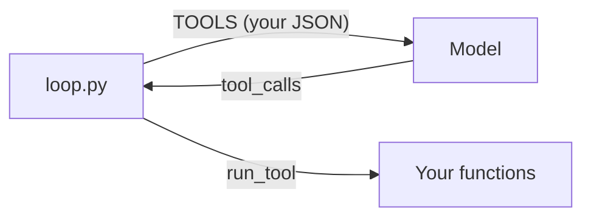
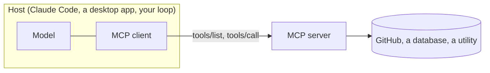

<style src="./style.css"></style>

<div class="kicker">Trinity College · November 16, 2026</div>

# AI Integration

<div class="big">The Model Context Protocol: your tools, callable by a host you did not write</div>

Ken Kousen · CPSC 415<br>Monday 1:30–4:10 · MC-225

<!--
1:30. Desk source switcher. Zoom auto-records: check the indicator. Wispr on,
pause at the break and resume. Due today: Week 8 (portfolio URL + tag),
Intro to MCP certificate, TP2 tag tp2-intent-spec.
-->

---

# This afternoon

| | |
|---|---|
| 1:30–1:40 | Due today; each team's TP2 task in a sentence |
| 1:40–2:05 | **What MCP is:** host, client, server |
| 2:05–2:20 | A server or a skill? |
| 2:20–2:55 | **The server in Python; Live A–C** |
| 2:55–3:10 | Break |
| 3:10–3:50 | **Live D–F:** your own loop, HTTP, a server you did not write |
| 3:50–4:10 | The lab: who owns which tool; what is due |

<!--
1:30–1:40. Six demos today; the build is the lab. The lab is TP2's Build
milestone, so the team time is project time. Ask each team for its
one-line TP2 idea now (not collected last week).
-->

---

# Last week's tool had one caller



- You wrote the schema, the loop sent it, the loop ran the function. All in one program.
- Claude Code could not call `lookup_project`. Neither could a desktop app or a teammate's loop.

<div class="statement">MCP: the same schema, published by a server, discovered and called by any host.</div>

<!--
1:40–1:44. Nothing about the model changes this week either. The model
still only asks. What changes is where the schema comes from and who can
reach the function.
-->

---

# Host, client, server



- The **host** owns the model and the user. Its **client** speaks the protocol. The **server** owns the tools.
- **stdio transport:** the host starts the server as a child process and exchanges JSON-RPC messages over its stdin and stdout.
- Remote servers use **streamable HTTP** instead: same messages, a URL in place of a child process.

<!--
1:44–1:50. Three roles. A server offers tools (the model asks for them),
resources (data the host attaches), and prompts (templates the user picks).
Today is tools, with one resource in the example. They met this vocabulary
in the Intro to MCP certificate.
-->

---

# A host that is not a coding agent

- Prof. Kousen's **Starfleet voice interface**: a JavaFX desktop app with a Spring AI MCP client. Speak a command; Whisper transcribes it (Week 7's first half).
- It starts his **osquery MCP server** (Java, Spring AI), which wraps the `osqueryi` utility: system state as SQL tables.
- "Computer, run a level one diagnostic" becomes tool calls, then SQL, then a spoken-style report.

<div class="note">Video: <a href="https://youtu.be/q8sXNXR6iKc">youtu.be/q8sXNXR6iKc</a> · <a href="https://github.com/kousen/starfleet-voice-interface">kousen/starfleet-voice-interface</a> · <a href="https://github.com/kousen/OsqueryMcpServer">kousen/OsqueryMcpServer</a></div>

<div class="statement">The server is Java. The host could be anything that speaks the protocol.</div>

<!--
1:50–2:00. Run the Starfleet app if it rehearsed; otherwise play the video
from the level-one-diagnostic section. Then register the same osquery
binary in Claude Code and ask the same question: second host, same server,
no code shared.
-->

---

# One capability, three front doors

| Front door | Who can use it | How it works |
|---|---|---|
| **MCP server** | Any MCP host, including a desktop or voice app with no shell | A running process; the host discovers the tools and calls them |
| **Spring AI client** | A program | Code that connects to the server and calls it directly |
| **Claude Code skill** | A coding agent with a shell | Instructions plus sample queries; the agent runs `osqueryi` itself, no server |

<div class="note">From the README of kousen/OsqueryMcpServer: the same diagnostics, offered three ways.</div>

<!--
2:00–2:05. In Claude Code, the skill is enough: osqueryi is on the machine
and the agent has a shell. The Starfleet app has no shell and no agent
harness, so it needs the server. The host decides, as much as the system.
-->

---

# A server or a skill?

- A **skill** is instructions plus local scripts. It needs a host with a shell and a file system.
- An **MCP server** is a running process with typed schemas, its own state, and its own credentials.

| Reach for a server when… | Examples |
|---|---|
| the system is **external** | Vercel, Railway, and Cloudflare each publish one |
| **more than one host** needs the same tools | Team Project 2 |

<div class="note">TP2 requires two hosts (Claude Code and your own loop). That is why it requires a server. Skills return in Week 11.</div>

<!--
2:05–2:20. Describe, don't rank: both are useful, and some vendors ship
both (a server for the hosted platform, a skill around their local CLI).
Ask each team: is your TP2 system external, or is it the two hosts that
make it a server? They should be able to say which. This sets up the
Subagents-or-Skills certificate (due Nov 30).
-->

---

# The server in Python

```python
from mcp.server import MCPServer                 # mcp SDK 2.3
mcp = MCPServer("portfolio")

@mcp.tool()
def recent_commits(
    repo: Annotated[str, Field(description="owner/name")],
    count: Annotated[int, Field(ge=1, le=10)] = 5,
) -> dict[str, Any]:
    """The most recent commits in a public GitHub repository.
    Use this before saying anything about recent work."""
    return github_tool.recent_commits(repo, count)  # Week 8's function

mcp.run()                                        # stdio
```

<!--
2:20–2:26. examples/mcp-server/server.py. The class was FastMCP in SDK
version 1 and was renamed MCPServer in version 2; older tutorials and
model training data still say FastMCP. Tell them to point the agent at the
current docs. pip install mcp.
-->

---

# The schema writes itself

<div class="two">
<div>

**Week 8, by hand**

```json
{"name": "recent_commits",
 "description": "The most recent commits…",
 "parameters": {"type": "object",
   "properties": {
     "repo": {"type": "string"},
     "count": {"type": "integer",
               "minimum": 1,
               "maximum": 10}},
   "required": ["repo"]}}
```

</div>
<div>

**Week 9, from the signature**

- Type hints become the JSON Schema.
- `Field(ge=1, le=10)` becomes `minimum` and `maximum`.
- The **docstring** is the description. It is still an instruction: "Use this before…"
- The SDK validates every call against it before your function runs.

</div>
</div>

<div class="note">The function underneath is the same file: <code>examples/tool-loop/github_tool.py</code>.</div>

<!--
2:26–2:30. Week 8's validate() was forty lines of their own code. Here the
SDK does it from the type hints. The description is still theirs to write,
and it still decides whether the model calls the tool.
-->

---

# Live A: a host with no model

```bash
cd examples/mcp-server
pip install -r requirements.txt
python3 client.py
```

```text
recent_commits: The most recent commits in a public GitHub repository. …
  schema: {"repo": {"type": "string", …},
           "count": {"default": 5, "maximum": 10, "minimum": 1, …}}

--- recent_commits with count=50 (the schema says 1 to 10)
is_error: True | … Input should be less than or equal to 10
```

- Start the server, list its tools, call one: everything a host does before a model is involved.

<!--
2:30–2:36. Open client.py: twenty lines. Client(StdioServerParameters(...)),
list_tools, call_tool. count=50 never reaches GitHub: the SDK refused it
from the schema. Free, no key.
-->

---

# Live B: Claude Code as the host

```json
{"mcpServers": {"portfolio": {"command": "python3", "args": ["server.py"]}}}
```

- `.mcp.json` in the project folder, committed: teammates get the server when they clone.
- Start `orclaude` there, approve the server, then `/mcp` lists it with its three tools.

```text
What did Sam learn from the receipt reader project, and what are the
two latest commits in kousen/ai-integration-course?
```

<div class="note">Rehearsed November 16 on both class models: the right two tools, 4 turns, 11–12 seconds each.</div>

<!--
2:36–2:44. Run it on M3, then MiMo. Point at the tool names:
mcp__portfolio__lookup_project. Claude Code asks permission the first time
each tool is used. Activate the venv before starting orclaude, or python3
will not find the mcp package.
-->

---

# The server holds the credential

```python
if os.environ.get("GITHUB_TOKEN"):
    token = os.environ["GITHUB_TOKEN"]
    req.add_header("Authorization", f"Bearer {token}")
```

- The token lives in the **server's** environment. The host never reads it; the model never sees it.
- The model gets a tool named `recent_commits` and a result. It cannot ask for the key, because nothing in the schema offers it.
- Week 4's key-on-server rule, one layer out: the browser did not hold the key then, and the model does not hold it now.

<!--
2:44–2:47. This is why vendors publish MCP servers for their platforms:
the deploy token stays in the server. In .mcp.json an "env" block passes
variables to the server; never commit a token there.
-->

---

# The server cannot see the user

```python
with open(PENDING, "a", encoding="utf-8") as f:
    f.write(json.dumps({"email": email, "message": message}) + "\n")
return {"sent": False, "pending": True,
        "note": "recorded for Sam to review; nothing was sent"}
```

- Week 8's loop could ask the visitor to confirm. A server cannot: it does not know who the host is.
- So `request_intro` **never sends**. It writes `pending.jsonl` for a person to review.
- The host's permission prompt is a second gate, not the only one.

<!--
2:47–2:50. Then the next slide: what happened in rehearsal.
-->

---

# What the rehearsal showed

Two headless runs on November 16, with `request_intro` not pre-approved:

| Run | The host | The server |
|---|---|---|
| MiMo | **denied** the call | nothing written |
| M3 | **allowed** it through | wrote the pending request; sent nothing |

- The M3 message added details the visitor never gave: a "30 minutes" meeting and a flexible schedule.

<div class="statement">The server's own gate held both times. A person reads the pending file.</div>

<!--
2:50–2:52. The host's gate depends on the host and its settings. A server
that is safe only under a careful host is not safe. And the pending file
is where someone catches what the model made up.
-->

---

# Live C: stdout is the wire

```python
def lookup_project(name: ...) -> dict[str, Any]:
    print("looking up", name)              # one debugging line
    return tools.lookup_project(name)
```

```text
$ python3 client.py
Failed to parse JSONRPC message from server
  Invalid JSON: expected value … [input_value='looking up receipt']
```

- Over stdio, the server's stdout carries the protocol. Anything else printed there is a broken message.
- Use `logging`: it writes to stderr, which the host shows you and never parses.

<!--
2:52–2:55. Add the print, run client.py, read the error, remove it. Their
coding agent will add print statements to debug; the lab's CLAUDE.md rule
forbids it. Then break.
-->

---

# Testing through the protocol

```python
async def test_wrong_type_is_rejected_before_the_function_runs():
    result = await call("lookup_project", {"name": 42})
    assert result.is_error

async def test_request_intro_records_and_never_sends(pending):
    args = {"email": "recruiter@example.com", "message": "Coffee?"}
    result = await call("request_intro", args)
    assert result.structured_content["sent"] is False
    assert pending.exists()
```

- `Client(mcp)` connects to the server **object**, in memory: no subprocess, no network, no model, no key.
- Nine tests, under a second, each call validated as a real host's would be.

<!--
After the break if 2:55 has passed; otherwise before it. Week 8's misuse
cases again, but the "scripted model" is now just a client sending bad
arguments. `async` is new to them: one sentence, the SDK's client is
asynchronous, and pytest runs it with the anyio marker in the file.
-->

---

# Errors are still results

| What happened | What goes back |
|---|---|
| Arguments do not fit the schema | `is_error: true`, with the validation message. Your function never ran. |
| `raise ToolError("no public repository named …")` | `is_error: true`, with your sentence. The model reads it and can correct itself. |
| The project is not on record | A **normal result**: `{"found": false, "projects_on_record": […]}` |

- Week 8's rule, unchanged: a problem goes back as something the model can read.
- Not found is an answer, not an error. Save `ToolError` for a call that failed.

<!--
One slide, short. The error message is what the model reads next: make
it say what to do.
-->

---

# Live D: your own loop as the second host

```python
async with Client(server) as mcp:
    # Week 8: from tools import TOOLS
    listed = (await mcp.list_tools()).tools
    tools = [{"type": "function", "function": {
        "name": t.name, "description": t.description,
        "parameters": t.input_schema}} for t in listed]
    ...
    # Week 8: run_tool(name, arguments)
    result = await mcp.call_tool(name, arguments)
```

- `host.py` imports nothing from `server.py`: it asks the server what it offers.
- The four messages and the step cap are Week 8's. One server, two hosts: Team Project 2.

<!--
3:20. python3 host.py "..." on M3, then --model xiaomi/mimo-v2.6-flash.
Rehearsed Nov 16: both models asked for both tools in one reply (parallel
calls); 5 s on M3, 25 s on MiMo in one run. Then the no-such-repo question: the ToolError comes back
as ERROR text and the model says so. `await` is the only new syntax: the
server is another process.
-->

---

# Live E: the same server over HTTP

```bash
python3 server.py --http        # stays running on localhost:8000
python3 host.py "..." --server http://localhost:8000/mcp
claude mcp add --transport http portfolio-http http://localhost:8000/mcp
```

| | stdio | Streamable HTTP |
|---|---|---|
| Who starts the server | each host, as a child process | you, once; hosts connect |
| Where it can run | the host's machine | anywhere with a URL |
| Changed in `server.py` | nothing | one argument to `mcp.run()` |

<div class="note">For TP2, stdio on your own machine is enough. HTTP is how a server becomes a service.</div>

<!--
3:30. Start the server in one terminal and leave it visible: every request
from either host prints a POST /mcp line. The tools did not change. Once it
has a URL it needs what any web service needs: authentication, a cap.
-->

---

# Live F: a server you did not write

```bash
claude mcp add --transport http context7 https://mcp.context7.com/mcp \
  --header "X-Api-Key: $CONTEXT7_API_KEY"
```

- **Context7** serves current documentation for libraries. Two tools: find the library, then query its docs.
- A remote server, over HTTP, run by someone else. The key (free) goes in a header and stays in the host's configuration.

<div class="statement">Local stdio, local HTTP, someone else's service: the host's side is the same three steps.</div>

<!--
3:40. /mcp to show context7 connected, then ask: "Using context7, show the
import and first line for a high-level server in the current mcp Python
SDK." Honest result from this morning: M3 also got it right without
Context7, in 7 turns and 50 s, by looking around on its own; with Context7,
3 turns and 14 s. This is what I use for external documentation; Vercel,
Railway and Cloudflare publish servers of the same shape.
-->

---

# The lab is TP2's Build milestone

<div class="two">
<div>

<span class="step">0</span> Team repository, venv, working rules<br>
<span class="step">1</span> Choose the first **two or three tools**<br>
<span class="step">2</span> The plan: files, order, Proof<br>
<span class="step">3</span> Misuse tests first, through `Client(mcp)`

</div>
<div>

<span class="step">4</span> The tool; the server starts<br>
<span class="step">5</span> `client.py`: a host with no model<br>
<span class="step">6</span> `.mcp.json`; Claude Code; a transcript<br>
<span class="step">7</span> `CHECKS.md`; tag `week09-submitted`

</div>
</div>

<div class="note">weeks/09/lab.md · in your team's TP2 repository · one submission and one grade per team · due November 23</div>

<!--
3:50. Walk the sheet. A team submission, one grade per team. Side-
effect tools are gated in the server, as request_intro is.
-->

---

# Before you go: which tools first

- Sit with your team for ten minutes. Open `spec.md` at the server's tool list.
- Choose the **two or three tools** the server needs first. They go in `plan.md`.
- One of them reads from the system your task is about. If any tool changes something, include that one.

<div class="statement">Is your system external, or is it the two hosts that make this a server?</div>

<!--
3:55. Ten minutes, in the room. Visit each team: the one-line task, the
tools in the spec, which one has a side effect and where its gate lives.
Nobody leaves without the first tools chosen.
-->

---

# Before November 23

- **Week 9 submission:** the team repository URL + `week09-submitted`. One submission, one grade per team.
- **TP2 milestones:** `plan.md`; the server running and registered in Claude Code; misuse tests for every tool.
- Week 10 is agents from scratch: `host.py` is the starting point for your own loop as TP2's **second host**.

<!--
4:05. Next week's loop is host.py with planning and stopping rules.
-->

---

# Before you leave

- What does a host do before the model is involved, and which two messages does it send?
- Where does the schema come from this week, and what did you write by hand last week that you did not write today?
- Why does `request_intro` never send, even though Claude Code asks permission?
- What happens when a server prints to stdout, and where should that line go?
- What changed in the server when it moved from stdio to HTTP, and what would it need before it had a public URL?

<!--
4:05–4:10. Answered aloud.
-->

---

# Sources and next steps

<div class="small">

- [Model Context Protocol](https://modelcontextprotocol.io/) · [MCP Python SDK](https://github.com/modelcontextprotocol/python-sdk) (version 2.3; `MCPServer` was `FastMCP` in version 1) · [Claude Code: MCP](https://docs.anthropic.com/en/docs/claude-code/mcp) · [Context7](https://context7.com/).
- [Introduction to Model Context Protocol](https://academy.claude.com/courses/introduction-to-model-context-protocol) (certificate due today).
- Prof. Kousen's Starfleet voice interface and osquery server: [video](https://youtu.be/q8sXNXR6iKc) · [kousen/starfleet-voice-interface](https://github.com/kousen/starfleet-voice-interface) · [kousen/OsqueryMcpServer](https://github.com/kousen/OsqueryMcpServer).
- `examples/mcp-server/` rehearsed November 16, 2026 in Claude Code on `minimax/minimax-m3` and `xiaomi/mimo-v2.6-flash`.

</div>

<p class="note">Prepared November 16, 2026.</p>
